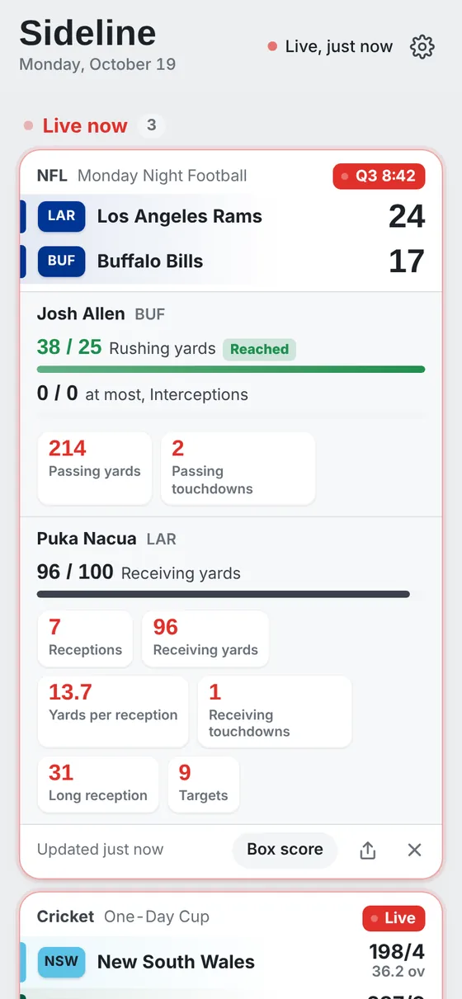
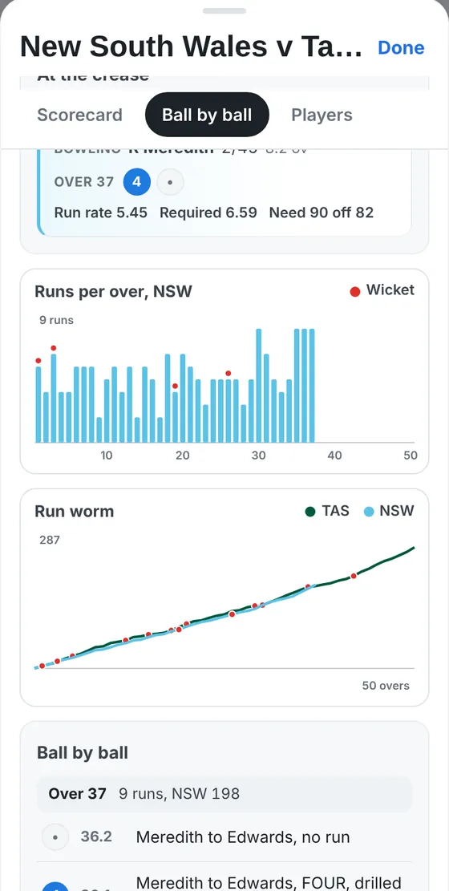
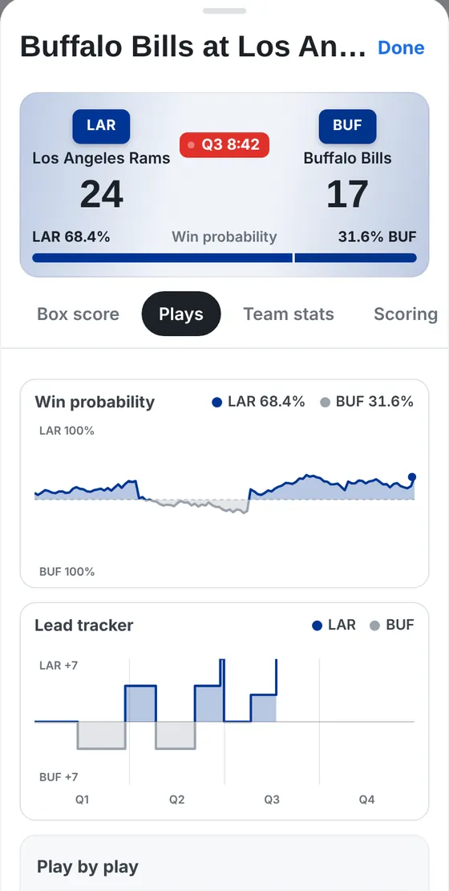
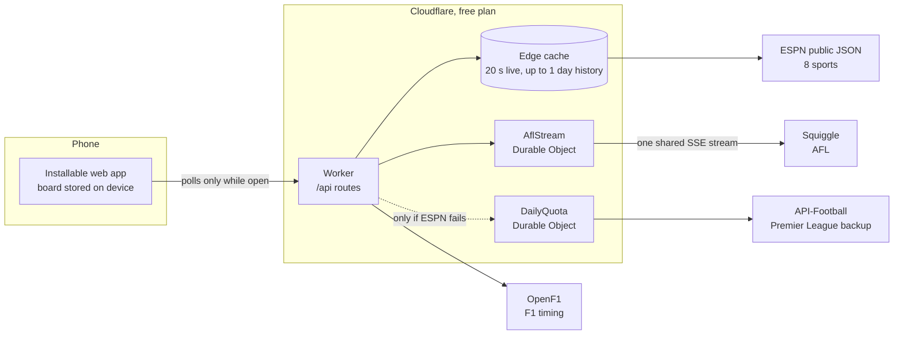

# Sideline

**Every game you're watching, on one screen.**

Sideline is an installable web app for following several live games at once: scores, full box scores, cricket ball by ball and the stats of the players you care about, across nine sports. It's free to use, needs no account, and runs entirely on free infrastructure.

[**Live app**](https://sideline.matchday1.workers.dev) · [**About and screenshots**](https://sideline.matchday1.workers.dev/about) · [**Sample board**](https://sideline.matchday1.workers.dev/?demo)


<p align="center">
  
  &nbsp;
  
  &nbsp;
  
</p>

**Sports:** NFL, NBA, AFL, NRL, Premier League, cricket (every series ESPN covers), UFC, PGA Tour golf and Formula 1.

---

## Features

- **One board for everything.** Follow games from any sport and see them grouped as Live now, Later and Finished. Favourite teams are added automatically a week ahead.
- **Player tracking.** Pin any player to a game card and choose which of their stats to show. Every stat in ESPN's box score is available, read generically rather than from a hard-coded list.
- **Targets.** Set a goal such as *at least 25 rushing yards*. A progress bar fills as the game goes and the app announces when it's reached.
- **Full game detail.** Box scores and cricket scorecards by team and innings, team stats with comparison bars, scoring plays, line-ups, form, injuries and match info.
- **Ball by ball and play by play.** The batters at the crease, the bowler, every ball of the current over and the required rate on the card; NFL drives, NBA plays and Premier League commentary in the game screen. Breaks in play show when play resumes, in the viewer's time zone.
- **Momentum charts.** Win probability and a lead tracker for the NFL and NBA; runs per over and a run worm for cricket.
- **F1 session timing.** Gaps, best laps, the fastest lap, tyre stints and pit stops after each session.
- **Share as a picture.** Any game card renders to an image for group chats.
- **Personalisation.** Light and dark themes, a compact board, and automatic clearing of finished games.

## Architecture



A single Cloudflare Worker serves the static app and a small JSON API. Every upstream feed is normalised into one `event` shape, so the client never knows which provider a score came from.

| Module | Responsibility |
|---|---|
| `src/worker.js` | Routing, edge caching, fallbacks, request limits, health check |
| `src/normalize.js` | Maps ESPN, Squiggle and API-Football onto one event model, including breaks in play |
| `src/players.js` | Reads four ESPN box-score formats into a uniform player and stat structure |
| `src/game.js` | Box scores, cricket scorecards, team stats, scoring plays, leaders, line-ups, match info |
| `src/plays.js` | Cricket ball by ball, NBA/NFL/soccer play by play, win probability and lead data |
| `src/history.js` | Team form and player game logs |
| `src/f1.js` | OpenF1 session timing |
| `src/afl-stream.js` | Durable Objects: the shared Squiggle SSE connection and the backup feed's daily quota |
| `public/` | The client: vanilla JavaScript modules, hand-drawn SVG charts, service worker |

## Engineering decisions

**Zero running cost as a hard constraint.** I designed the app around Cloudflare's free plan rather than a traditional server. The constraint shaped most of the other decisions.

**Shared caching instead of per-user polling.** Upstream requests are cached at the edge for 20 seconds, so ESPN sees about three requests a minute per feed, however many people are watching. History is cached far longer: finished pages of the cricket ball-by-ball feed never change, so they're kept for a day and only the newest page is re-read.

**Streaming where the provider asks for it.** Squiggle requests that live AFL scores come from its Server-Sent Events API rather than polling. A Durable Object holds one shared stream open only while someone is watching and closes it five minutes after the last viewer leaves, reconnecting with exponential backoff.

**Defensive parsing of an undocumented API.** ESPN's feed varies by sport and changes without notice. The parsers never hard-code stat names and fall back gracefully when fields are missing. When I tested against live matches I found and fixed real discrepancies. Examples:
- cricket strike rates were truncated rather than rounded;
- dismissals arrived as player ids rather than names;
- matches at stumps were still marked "in progress".

**A client that respects the device.** The app polls only while visible: every 20 seconds during live play, every minute near kick-off, and slower again during breaks such as stumps. There's no framework or build step; the whole client is about 60 KB compressed.

**Protection without hurting real users.** Per-device and per-network request limits sit about six times above the heaviest genuine use, and a limited client backs off quietly instead of showing an error. Failures are logged as structured JSON, and `/api/health` supports external uptime monitoring.

**Accessibility.** Text meets WCAG AA contrast in both themes, controls are labelled for screen readers, and tap targets are at least 24px.

## Testing

```bash
npm test
```

43 unit tests use Node's built-in test runner (no dependencies) and pin the exact shape of every data feed: score normalisation, box-score parsing, cricket scorecards, play by play, team form and F1 timing. GitHub Actions runs them on every push and deploys to Cloudflare only when they pass.

## Running it yourself

```bash
npm install
npx wrangler login
npx wrangler secret put CONTACT_EMAIL   # required by Squiggle
npm run deploy
```

See [docs/DEPLOYMENT.md](docs/DEPLOYMENT.md) for the full guide: secrets, continuous deployment, request limits, logging, uptime alerts and capacity.

## How I built it

I built Sideline as a personal project, using an AI coding assistant (Claude) as a pair programmer.
- **What I did:** I defined the product, made the design and trade-off decisions, and tested every feature against live matches. I found and diagnosed the bugs and directed the fixes.
- **What the AI did:** it drafted much of the code.

Working this way let me ship a far broader app than I could alone, while staying responsible for how it works and why.

## Roadmap

- Push notifications for wickets, scores and targets when the app is closed
- Live F1 timing (OpenF1's live tier is paid)
- Android listing on Google Play

## Data and credits

Scores and stats from [ESPN](https://www.espn.com), AFL from [Squiggle](https://squiggle.com.au), F1 timing from [OpenF1](https://openf1.org), and [API-Football](https://www.api-football.com) as a backup.

Sideline is an independent, non-commercial project. It isn't affiliated with or endorsed by ESPN, Squiggle, OpenF1, Formula 1, the NFL, NBA, AFL, NRL, Premier League, any cricket board or any team.

Built by Aryan Chugh.
